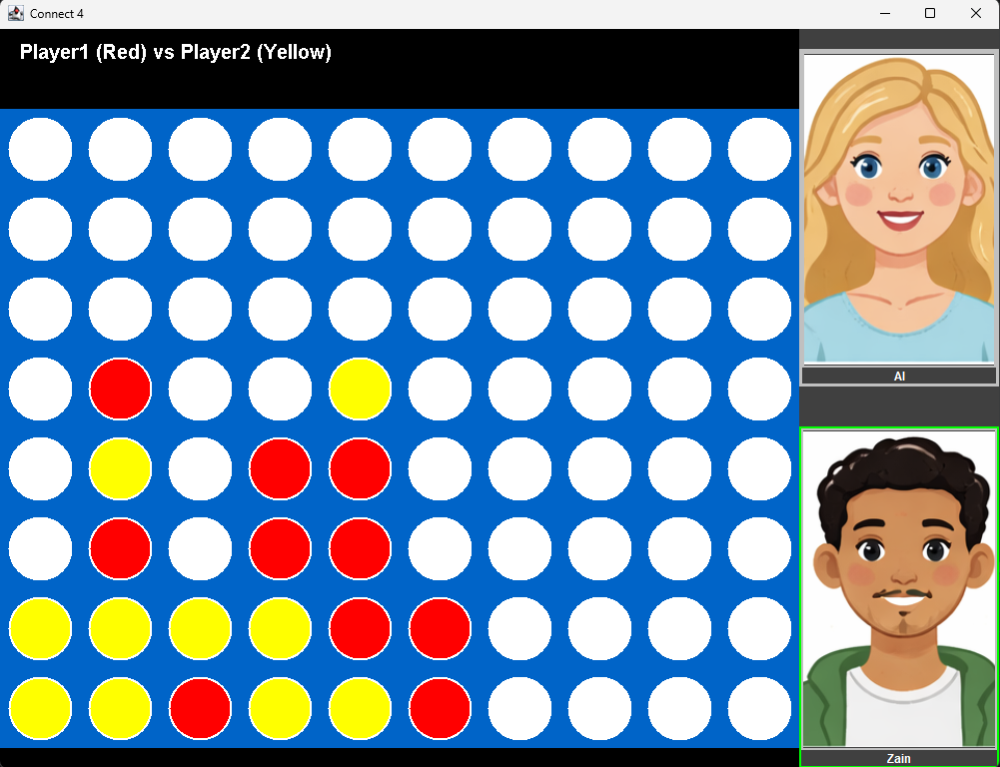

# Connect N

Connect N is a Java board-game project created for a CS 211 programming assignment. It was designed as a customizable take on Connect Four, with configurable board dimensions and a selectable number of pieces needed to win.

## Demonstration

The screenshot below records a game in progress, including the board, player pieces, and avatars. It was captured before the instructor-provided interface implementation was removed from the source.

## My Contributions

I contributed to several parts of the project:

- **Game board:** Implemented board setup and validation, move validation, simulated piece drops, board-state copying, and full-board detection.
- **Game engine:** Implemented win detection for horizontal, vertical, and both diagonal directions, along with move handling and integration of computer turns into the game flow.
- **Custom collection:** Built an array-backed `MyArrayList` with indexed and append operations, retrieval, removal, size and emptiness checks, searching, and iteration support.
- **Iterator:** Implemented `MyIterator` to traverse the custom list and report when there are no more elements.
- **Utilities:** Implemented bad-word list loading and checking, even/odd checks, and counting pieces in a board column.
- **Player classes:** Implemented the human and computer player constructors that connect each player type to the shared player data.

## Course-Provided Code

The original assignment included substantial instructor-provided implementations and interface code. To avoid republishing those course materials, I removed the instructor-provided implementations and replaced them with comments describing their purpose. I retained my own contributions.

Because some course-provided code was removed, this repository is a partial, sanitized record of the project and may not compile or run as a complete game. The screenshot is included as a visual record of the original application.

## Technologies

- Java
- Java Swing
- Object-oriented programming
- Recursion and game-tree search concepts

## Project Structure

- `code/` — Java source files
- `resources/` — Avatar images used by the original interface
- `bad_words.txt` — Word list used for player-name validation
- `screenshots/` — Gameplay screenshot

## Academic Context

Created as a programming project for **CS 211**.
